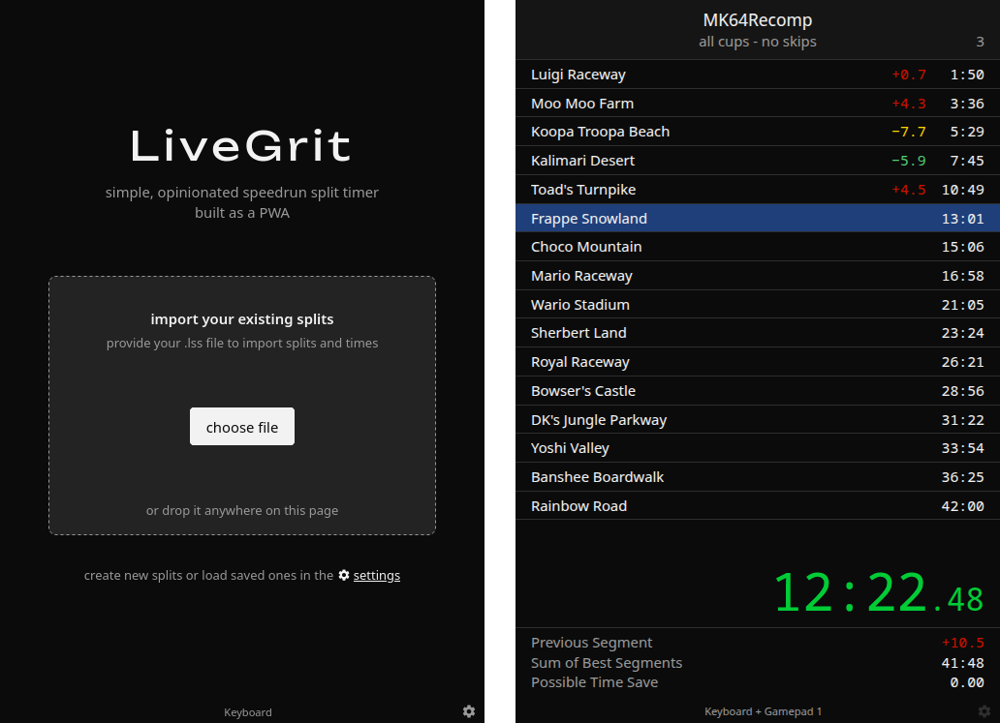
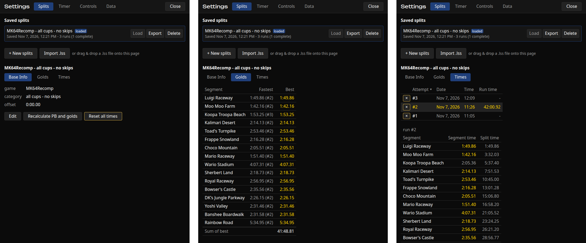
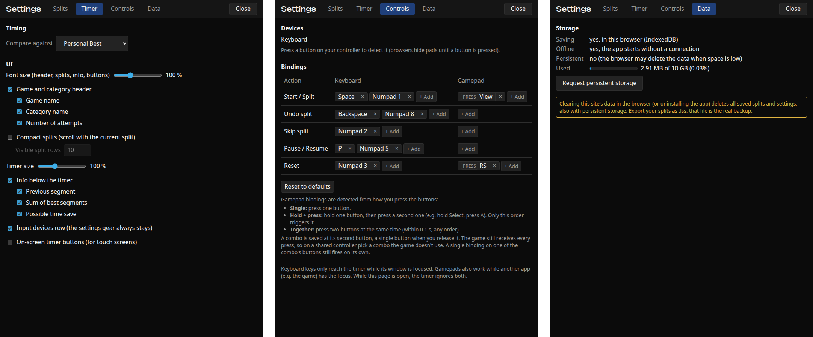

# LiveGrit

A browser-only, installable (PWA) speedrun split timer that looks and behaves similar to LiveSplit.

It's built with Svelte 5, TypeScript and Vite, and uses [livesplit-core](https://github.com/LiveSplit/livesplit-core), compiled to WebAssembly, for all timing and split logic.

> Try [LiveGrit](https://kryptografisch.github.io/livegrit) now.

## Usage

- **In the browser:** open the page and use it directly, no install needed.
- **As an app:** install it to your desktop or home screen (PWA). It then runs in its own window and works offline.
- **OBS window capture:** run the app or the browser version in its own window and capture that window.

## Development

See [docs/development.md](docs/development.md).

## Roadmap

See [docs/future-features.md](docs/future-features.md) for what's next.

## License

Licensed under the [Apache License, Version 2.0](LICENSE).

Exception: `vendor/livesplit-core/` is the built [livesplit-core](https://github.com/LiveSplit/livesplit-core), licensed under MIT or Apache-2.0.
