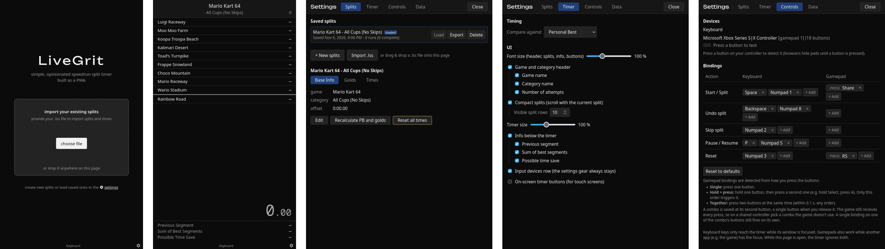

# LiveGrit

A browser-only, installable (PWA) speedrun split timer that looks and behaves similar to LiveSplit.
It's built with Svelte 5, TypeScript and Vite, and uses [livesplit-core](https://github.com/LiveSplit/livesplit-core), compiled to WebAssembly, for all timing and split logic.

Try [LiveGrit](https://kryptografisch.github.io/livegrit) now.

## Usage

- **In the browser:** open the page and use it directly, no install needed.
- **As an app:** install it to your desktop or home screen (PWA). It then runs in its own window and works offline.
- **OBS window capture:** run the app or the browser version in its own window and capture that window.

## Development

See [docs/development.md](docs/development.md).

## Browser limitations

- **Storage eviction:** runs and settings live in IndexedDB. Safari may delete storage written by scripts after about 7 days without use unless the app is installed to the Home Screen. The persistent-storage request is best effort (its status is shown in Settings → Data). Export your splits as `.lss` regularly.
- **No global hotkeys:** a browser only gets key presses while the page has focus. Gamepads are read through the Gamepad API, which also needs the page to be visible (and in some browsers focused).
- **Background tabs:** browsers throttle hidden tabs, so the display stops updating, but the time stays correct (livesplit-core uses timestamps).
- **Installing:** only Chromium browsers (Chrome, Edge, Android) offer a real install button. Safari, Firefox on Android and Samsung Internet install through their menus (the app shows instructions). Desktop Firefox can't install PWAs. Installing and offline mode need https (or `localhost`).
- **Several windows:** the app can only reliably tell whether a Settings window is open when Web Locks are available, which needs a secure context (https or `localhost`).
- **Screen wake lock:** the screen stays awake during an attempt only in browsers that support the Screen Wake Lock API.

## Roadmap

See [docs/future-features.md](docs/future-features.md) for what's next.

## License

Licensed under the [Apache License, Version 2.0](LICENSE).

Exception: `vendor/livesplit-core/` is the built [livesplit-core](https://github.com/LiveSplit/livesplit-core), licensed under MIT or Apache-2.0.
